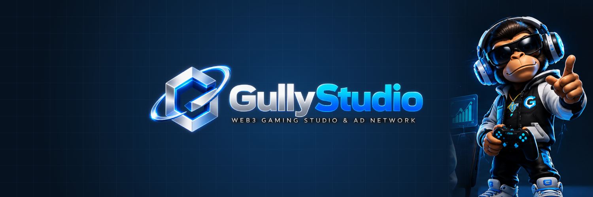

<!-- gully-header:start -->
<a href="https://gullystudio.xyz"></a>

<p align="center">
  <a href="https://gullylabs.xyz"></a>
  <a href="https://gullystudio.xyz"></a>
  <a href="https://docs.gullylabs.xyz"></a>
  <a href="https://x.com/Gully_Labs"></a>
  <a href="https://t.me/GullyLabsNews"></a>
  <a href="https://github.com/gully-labs"></a>
</p>

<p align="center"><b>Gully Game SDK: Unity client for Gully ID sign-in, Gully Chain reads, Gully Pay x402 pay-per-call and Gully Arcade score attestation. MIT.</b></p>

<p align="center"><sub>Built by <a href="https://gullylabs.xyz">Gully Labs</a>. You Think It, We Ship It.</sub></p>

---
<!-- gully-header:end -->

<p align="center"><a href="https://gullystudio.xyz"></a></p>

# Gully Game SDK

Unity (6 LTS) client for the services every [Gully Studio](https://gullystudio.xyz) game uses, open to any Unity
developer building on [Gully Chain](https://gullychain.xyz). MIT.

| Area | Class | What it does |
|---|---|---|
| **Gully ID** | `GullyIdClient`, `LoopbackRedirectListener`, `DeepLinkRedirect`, `IdToken` | Sign in with Gully: OIDC authorization code + PKCE against `https://id.gullychain.xyz` (public client), refresh, `/v1/me`, id_token claims incl. `gully_account` |
| **Gully Chain** | `JsonRpcClient`, `Abi`, `Keccak256`, `Erc20`, `GullyChain` | JSON-RPC reads (chain 485590 testnet via `https://testnet-rpc.gullychain.xyz` or your Gully RPC key), ABI encode/decode, selectors, EIP-55, ERC-20 |
| **Gully Pay** | `X402Client` | x402 pay-per-call: parse a 402, pay the Gully Chain option, retry with `X-PAYMENT` |
| **Gully Arcade** | `GullyArcadeClient`, `ArcadeAbi` | run tickets + score attestation (`testnet-arcade.gullychain.xyz`), `submitScore` calldata, season and leaderboard reads from `GullyArcade` |
| **Wallet seam** | `ITransactionSender` | the one interface you implement with the player's account; the SDK holds no keys |

## Status: work in progress (v0.1.0, 2026-10-25)

**Working against live services:** Gully Chain reads (RPC, ABI, ERC-20), Arcade reads (season, leaderboard, best
score), Arcade run tickets and attestation (season 1 of Frog Hop is live on testnet), `submitScore` calldata, OIDC
URL/PKCE/token exchange/claims, x402 requirement parsing and payment-transaction building.

**Stubbed / on you:** sending transactions (`ITransactionSender`: wire it to the player's Gully ID passkey smart
account via session keys, or to a wallet), id_token **signature verification** (do it on your server with the JWKS),
Gully Pay verification (`POST /x402/pay` is called by your resource server with its API key, never by the game), and
a Gully ID public OIDC client (register it on the Gully ID box, see `gully-id/docs/integration.md`).

## Install

Unity 6 LTS (6000.0+). Package Manager > **Add package from git URL**:

```
https://github.com/gully-labs/gully-game-sdk.git#v0.1.0
```

or in `Packages/manifest.json`:

```json
"xyz.gullylabs.gamesdk": "https://github.com/gully-labs/gully-game-sdk.git#v0.1.0"
```

The samples (Arcade Quickstart, Sign in with Gully, Pay per call) import from the package's Samples tab.

## Quick start

```csharp
using GullyLabs.GameSdk;

// Chain reads: public testnet RPC by default; production games use their Gully RPC key.
var rpc = new JsonRpcClient(GullyChain.GullyRpcUrl("<your-gully-rpc-project>")); // or new JsonRpcClient()
long block = await rpc.BlockNumberAsync();
var weth = await Erc20.BalanceOfAsync(rpc, GullyChain.TestnetWeth, player);

// Arcade: start a run, play from the seed, attest, submit.
var arcade = new GullyArcadeClient(rpc: rpc);
var run = await arcade.StartRunAsync(gameId: 1);
var attestation = await arcade.AttestAsync(run.ticket, new ArcadeRunLog { seed = run.seed, taps = taps }, player, score);
string txHash = await arcade.SubmitScoreAsync(attestation, mySender);     // mySender : ITransactionSender
var board = await arcade.LeaderboardAsync(attestation.seasonId);

// Sign in with Gully (desktop/editor; mobile uses DeepLinkRedirect with a custom scheme).
using var listener = new LoopbackRedirectListener(53682);
var id = new GullyIdClient(new GullyIdConfig { ClientId = "my-game", RedirectUri = listener.RedirectUri });
var auth = id.BeginAuthorization();
Application.OpenURL(auth.Url);
var code = GullyIdClient.ParseCallback(await listener.WaitForCallbackAsync(), auth.State);
var session = await id.ExchangeCodeAsync(code, auth);      // session.Claims.sub, .email, .gully_account.address

// Pay per call through Gully Pay.
var paid = await new X402Client().GetAsync("https://your-backend/paid/level-7", mySender);
```

## How the pieces fit

```
Unity game ──GullyIdClient──▶ id.gullychain.xyz (Hydra OIDC)        sub, email, gully_account
          ──JsonRpcClient──▶ testnet-rpc.gullychain.xyz / rpc.gullyrpc.xyz/<key>/evm/485590
          ──GullyArcadeClient──▶ testnet-arcade.gullychain.xyz (/v1/run, /v1/attest) + GullyArcade contract
          ──X402Client──▶ your resource server ──(API key)──▶ gullypay.xyz/api/x402/pay
          ──ITransactionSender──▶ player's account (passkey smart account, sponsored gas)
```

Gully Chain Testnet: chain id `485590`, explorer `https://testnet-explorer.gullychain.xyz`, GullyArcade v1.0 at
`0xe573789b235314661DEdDA08a18Ca261c069c872`. Mainnet constants are added when the chain launches.

## Brand defaults

`GullyStudioTheme` carries the GullyStudio brand tokens (navy `#06121F`, Studio blue `#1E8BFF`, cyan `#19D3FF`,
green `#2EE68A`, silver `#E8EEF5`, muted `#8FA6C2`, the cyan-to-blue Studio gradient, Montserrat) and
`GullyStudioTheme.ApplyTo(Camera.main)` sets the sample scenes' clear colour. Brand files in `Documentation~/brand/`
are byte-exact kit copies; the full kit is served at https://gullystudio.xyz/brand/.

## Design notes

- `JsonUtility` only (no JSON dependency); request bodies are built by hand, responses map to `[Serializable]` DTOs.
- Pure helpers (`Hex`, `Keccak256`, `Abi`, `ArcadeAbi`, `Pkce`, `Base64Url`) have no `UnityEngine` reference and are
  unit-tested with known vectors (Keccak test vectors, RFC 7636 B, GullyArcade selectors).
- Nothing in this package is from the Unity Asset Store; Gully Studio game repos are private for that reason, this
  one is public.
- No secrets: no API keys, no signer keys, no licence files. CI lints for them.

## Development

```
node Tools~/gen-meta.mjs       # .meta for new files (UPM git packages must ship them)
node Tools~/check-package.mjs  # lint: package.json, asmdefs, metas, secrets
```

Run the EditMode tests from a Unity 6 project that references this package. `.github/workflows/ci.yml` runs the lint
on every push and the Unity tests when the repository variable `UNITY_CI=true` and the licence secrets exist.

## Licence

MIT, see `LICENSE.md`. (c) 2026 Gully Labs.
